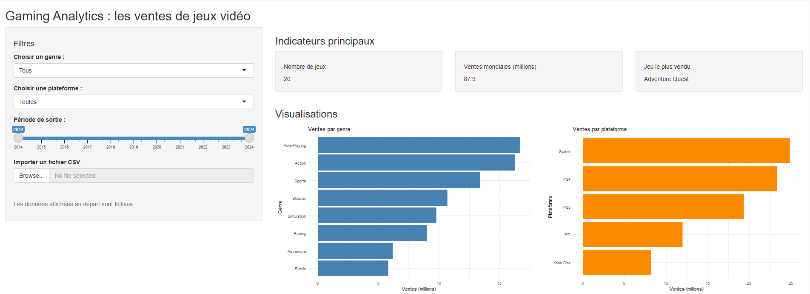
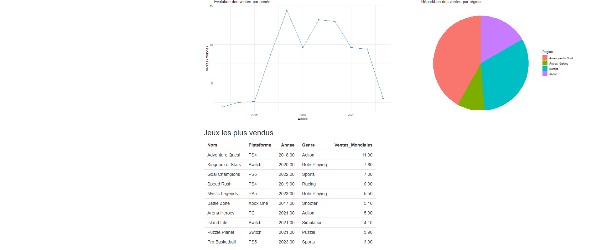

# Gaming Analytics — Analyse des ventes de jeux vidéo

## 1. Présentation du projet

Ce projet consiste à réaliser un tableau de bord interactif sur le thème des jeux vidéo. Il permet d'explorer les ventes selon plusieurs critères : le genre, la plateforme, l'année de sortie et la région.

Le dashboard a été développé avec **R**, **Shiny** et **ggplot2**, dans le cadre du travail individuel sur la visualisation de données.

## 2. Fonctionnalités

- Filtres interactifs par genre, plateforme et période.
- Indicateurs principaux : nombre de jeux analysés, ventes mondiales cumulées et jeu le plus vendu.
- Graphique des ventes par genre.
- Graphique des ventes par plateforme.
- Courbe d'évolution des ventes par année.
- Diagramme circulaire de la répartition des ventes par région.
- Tableau des jeux les plus vendus selon les filtres sélectionnés.

## 3. Captures d'écran

### Vue générale du dashboard

### Visualisations et tableau des jeux les plus vendus

## 4. Technologies utilisées

- **R** : traitement des données et logique de l'application.
- **Shiny** : création de l'interface interactive.
- **ggplot2** : réalisation des graphiques.

## 5. Données utilisées

Les captures actuelles utilisent des données fictives de démonstration intégrées au projet pour tester l'interface et les filtres. Elles ne représentent donc pas les ventes réelles du marché du jeu vidéo.

Pour une analyse réelle, un jeu de données peut être téléchargé ici :

https://www.kaggle.com/datasets/gregorut/videogamesales

## 6. Conclusion

Ce tableau de bord permet de comparer les ventes selon les genres et les plateformes, d'observer leur évolution dans le temps et d'étudier leur répartition par région. Les filtres interactifs facilitent l'exploration des données et la comparaison des résultats.
