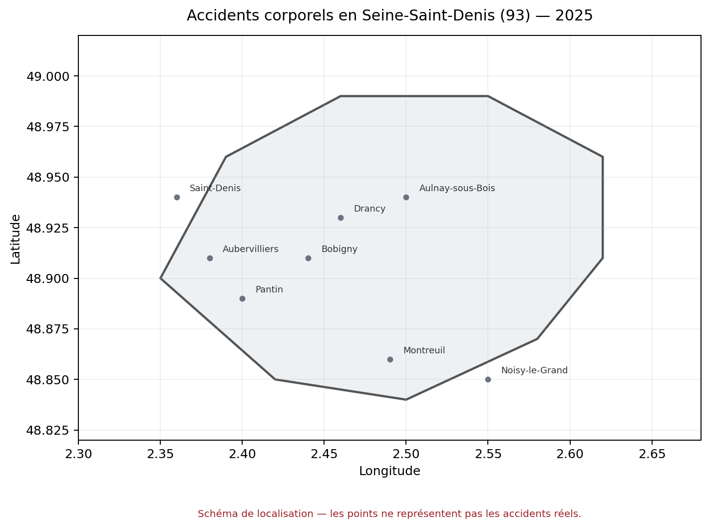
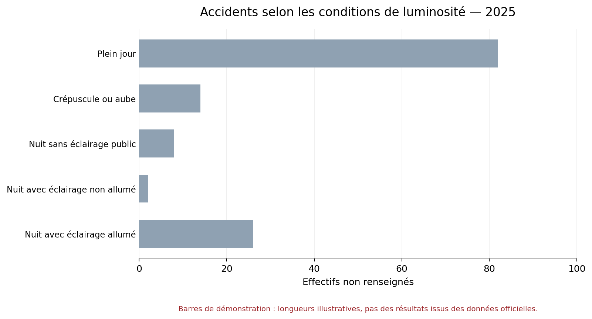

# Accidents routiers en Seine-Saint-Denis (2025)

## Répartition géographique

La carte présente plusieurs communes de Seine-Saint-Denis.
Elle permet de situer le territoire étudié.
Les points indiquent les communes et non les accidents réels.

## Accidents selon la luminosité

Le graphique compare les accidents selon cinq conditions de luminosité.
Le plein jour est représenté par la barre la plus longue.
Les effectifs affichés sont illustratifs et non issus des données officielles.

