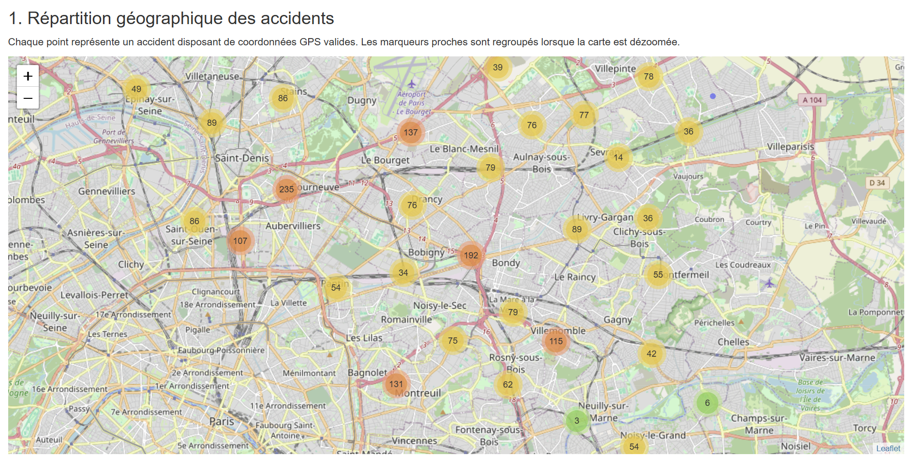

# Accidents routiers en Seine-Saint-Denis (2025)

## Répartition géographique

La carte présente plusieurs communes de Seine-Saint-Denis, notamment Saint-Denis, Aubervilliers, Bobigny et Montreuil. Les points permettent de repérer leur position géographique grâce aux coordonnées de longitude et de latitude. Cette représentation donne un aperçu du territoire étudié.

## Accidents selon la luminosité

Le plein jour présente la barre la plus longue, suivi de la nuit avec éclairage allumé et du crépuscule ou de l'aube. Les autres catégories sont moins représentées dans le graphique.

