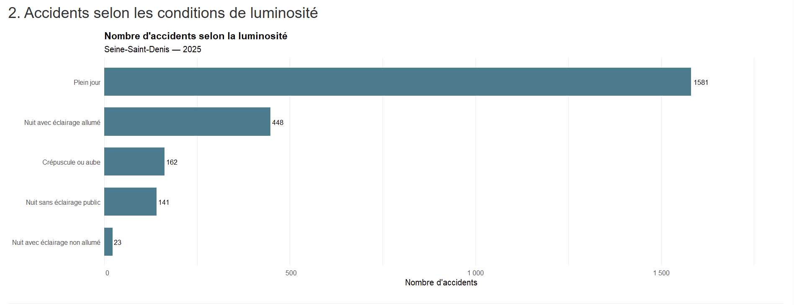

# Accidents routiers en Seine-Saint-Denis (2025)

## Répartition géographique

La carte interactive représente les accidents disposant de coordonnées géographiques valides. Les cercles regroupent les marqueurs proches et indiquent le nombre d'accidents dans chaque regroupement. Le zoom permet d'observer leur localisation plus précisément. L'application affiche 2 355 accidents, dont 2 355 accidents géolocalisés.

## Accidents selon la luminosité

Le graphique compare le nombre d'accidents selon les conditions de luminosité. Les barres sont classées de la valeur la plus élevée à la plus faible et les effectifs sont affichés directement. 

